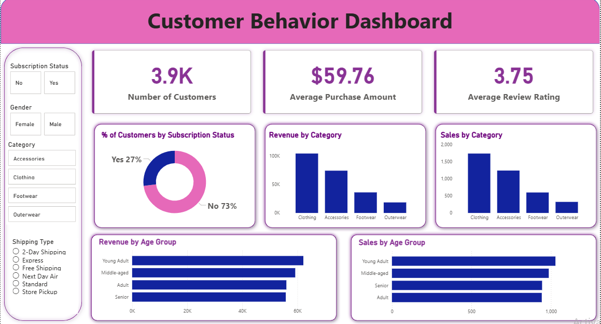

# Customer Shopping Behavior Analysis

## Project Overview

This project focuses on analyzing customer shopping behavior using transactional data containing **3,900 records and 18 columns**.

The primary objective is to identify customer purchasing patterns, spending behavior, product preferences, subscription trends, and customer segments to generate actionable business insights.

The project follows an end-to-end data analytics workflow using Python, PostgreSQL, SQL, and Power BI, transforming raw transactional data into meaningful business insights and interactive visualizations.

## Business Objectives

- Understand customer purchasing and spending patterns.
- Analyze revenue contribution across customer demographics.
- Identify top-performing products and categories.
- Evaluate the relationship between discounts and purchasing behavior.
- Compare subscribers and non-subscribers.
- Segment customers based on previous purchase history.
- Identify opportunities to improve customer retention and revenue.

## Dataset Overview

| Dataset Attribute | Details |
|---|---|
| Total Records | 3,900 |
| Total Columns | 18 |
| Missing Values | 37 in Review Rating |
| Dataset Type | Customer Shopping Transactions |

### Key Features

**Customer Demographics**
- Customer ID
- Age
- Gender
- Location
- Subscription Status

**Purchase Details**
- Item Purchased
- Category
- Purchase Amount
- Season
- Size
- Color

**Shopping Behavior**
- Discount Applied
- Promo Code Used
- Previous Purchases
- Frequency of Purchases

**Customer Experience**
- Review Rating
- Shipping Type

## Technologies Used

| Technology | Purpose |
|---|---|
| Python | Data cleaning and exploratory analysis |
| Pandas | Data manipulation and preprocessing |
| NumPy | Numerical operations |
| Seaborn | Statistical visualization |
| PostgreSQL | Database management |
| SQL | Business analysis and querying |
| Power BI | Interactive dashboard development |
| Jupyter Notebook | Python development environment |
| Git & GitHub | Version control and project hosting |

## Project Workflow

### 1. Data Cleaning and Exploratory Data Analysis (Python)

Performed initial data exploration and preprocessing using Python and Pandas.

Key activities:

- Imported the dataset using Pandas.
- Examined dataset structure using `df.info()` and `df.describe()`.
- Identified missing values and checked data consistency.
- Imputed 37 missing Review Rating values using the median rating of the corresponding product category.
- Standardized column names using snake_case.
- Created an `age_group` feature to categorize customers by age.
- Examined the relationship between `discount_applied` and `promo_code_used` to identify redundancy.
- Prepared the cleaned dataset for database integration.

### 2. Database Integration (PostgreSQL)

Integrated the cleaned dataset into PostgreSQL for structured data storage and SQL analysis.

Key activities:

- Established a PostgreSQL connection using Python.
- Created the database and required table.
- Loaded the cleaned DataFrame into PostgreSQL.
- Verified imported records and table structure.
- Prepared data for business-focused SQL queries.

### 3. Business Analysis Using SQL

Performed SQL analysis in PostgreSQL to answer 10 important business questions.

| No. | Business Analysis | Objective |
|---|---|---|
| 1 | Revenue by Gender | Compare revenue generated by male and female customers. |
| 2 | High-Spending Discount Users | Identify customers who used discounts but spent above the average purchase amount. |
| 3 | Top 5 Products by Rating | Find products with the highest average review ratings. |
| 4 | Shipping Type Comparison | Compare average purchase amounts between Standard and Express shipping. |
| 5 | Subscribers vs. Non-Subscribers | Compare average spending and total revenue by subscription status. |
| 6 | Discount-Dependent Products | Identify five products with the highest percentage of discounted purchases. |
| 7 | Customer Segmentation | Classify customers into New, Returning, and Loyal segments. |
| 8 | Top 3 Products per Category | Identify the three most purchased products within each category. |
| 9 | Repeat Buyers and Subscriptions | Examine whether customers with more than five previous purchases are more likely to subscribe. |
| 10 | Revenue by Age Group | Calculate revenue contribution across different age groups. |

### 4. Power BI Dashboard Development

Developed an interactive Power BI dashboard to visualize customer shopping behavior and key business metrics.

**Dashboard Highlights**

- Total customer count / transaction count.
- Average purchase amount.
- Average customer review rating.
- Customer subscription distribution.
- Revenue by product category.
- Sales by product category.
- Revenue by age group.
- Sales by age group.

**Interactive Filters**

- Subscription Status
- Gender
- Product Category
- Shipping Type

### Dashboard Preview



## Key Business Insights

Based on the displayed Power BI dashboard:

| KPI / Metric | Dashboard Value |
|---|---:|
| Displayed customer count | 3.9K |
| Average Purchase Amount | $59.76 |
| Average Review Rating | 3.75 |
| Subscription Adoption | 27% |
| Non-Subscribers | 73% |

**Category Performance**
- Clothing contributes the highest revenue among the displayed categories.
- Clothing also records the highest sales volume.
- Accessories is the second-highest category in both displayed charts.

**Customer Demographics**
- Young Adult customers contribute the highest revenue in the displayed age-group chart.
- The dashboard allows comparison of revenue and sales across customer age groups.

**Subscription Behavior**
- 73% of customers are non-subscribers.
- Subscription adoption stands at 27%, indicating an opportunity to improve subscription conversion.

## Business Recommendations

**1. Increase Subscription Adoption**

Introduce exclusive subscriber benefits, personalized offers, and subscription-based rewards.

**2. Improve Customer Retention**

Implement loyalty programs to encourage repeat purchases and convert returning customers into loyal customers.

**3. Optimize Discount Strategies**

Evaluate discount-dependent products and balance promotional campaigns with profitability.

**4. Improve Product Marketing**

Promote high-performing product categories and highly rated products through targeted marketing campaigns.

**5. Implement Targeted Marketing**

Focus marketing campaigns on high-revenue customer segments and understand the purchasing preferences of different age groups.

## Repository Structure

```text
customer-shopping-behavior-analysis/
│
├── data/
│   ├── shopping_behavior.csv
│   └── cleaned_shopping_data.csv
│
├── python/
│   ├── data_cleaning_eda.ipynb
│   └── database_connection.py
│
├── sql/
│   └── business_analysis.sql
│
├── powerbi/
│   ├── customer_shopping_dashboard.pbix
│   └── dashboard_overview.png
│
├── reports/
│   └── analysis_charts.png
│
├── README.md
├── requirements.txt
└── .gitignore
```

## How to Run the Project

### Prerequisites

- Python 3.x
- PostgreSQL
- Jupyter Notebook
- Power BI Desktop

### Step 1: Clone the Repository

```bash
git clone https://github.com/manojakumarsahu618/customer-shopping-behavior-analysis.git
```

### Step 2: Navigate to the Project Directory

```bash
cd customer-shopping-behavior-analysis
```

### Step 3: Install Required Libraries

```bash
pip install -r requirements.txt
```

### Step 4: Run Python Analysis

```bash
jupyter notebook
```

Open the Python notebook and execute the data cleaning and EDA steps.

### Step 5: Configure PostgreSQL

Create the database, configure your PostgreSQL credentials, and execute the database integration script.

### Step 6: Execute SQL Queries

Open the SQL script in PostgreSQL and execute the business analysis queries.

### Step 7: Open Power BI Dashboard

Open the `.pbix` file using Power BI Desktop and configure the data source if required.

## Skills Demonstrated

- Data Cleaning and Preprocessing
- Exploratory Data Analysis (EDA)
- Python Programming
- SQL Query Writing
- PostgreSQL Database Integration
- Customer Segmentation
- Business Analysis
- Data Visualization
- Power BI Dashboard Development
- Business Insights and Recommendations

## Author

**Manoja Kumar Sahu**

MCA Graduate | Aspiring Data Analyst

- GitHub: [manojakumarsahu618](https://github.com/manojakumarsahu618)
- LinkedIn: [Manoja Kumar Sahu](https://linkedin.com/in/manoja-kumar-sahu-7477642aa)

---

If you find this project useful, feel free to explore the repository and give it a star!
